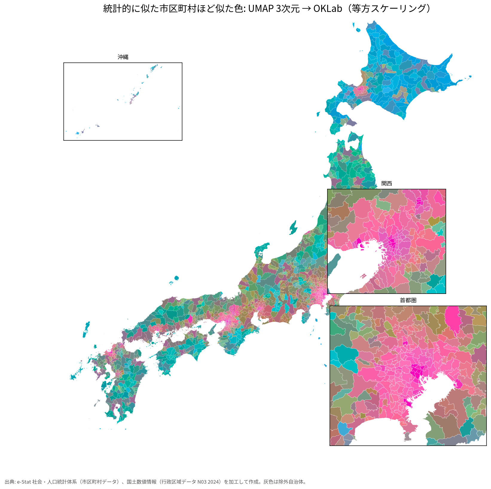

# 市区町村 統計類似色マップ

全国の市区町村（政令指定都市は区単位、1,890地域）を43の統計指標で多次元ベクトル化し、

1. 各市区町村に **統計的に似ている市区町村 Top10** を提示
2. 類似関係を3次元に圧縮して **知覚的に均等な色空間（OKLab）** に写し、「似ている市区町村ほど似た色」になる地図を作成

するプロジェクトです。



## 使い方（Webマップ）

```bash
cd web && python3 -m http.server 8765
# http://localhost:8765/ を開く
```

- 配色の切り替え: UMAP/PCA × OKLab/RGB直接、k-meansクラスタ
- 地図・3D散布図・検索で市区町村を選ぶと、類似Top10（地図上で枠線表示）と指標プロファイルを表示
- 類似リストの行をクリックすると、2地域の指標を並べて比較

## データ

| ソース | 内容 |
|---|---|
| e-Stat 社会・人口統計体系「市区町村データ 基礎データ（廃置分合処理済）」 `0000020201`〜`0000020211` | 人口・世帯、自然環境、経済基盤、行政基盤、教育、労働、居住、健康・医療、福祉、安全 |
| e-Stat 令和2年国勢調査 `0003445129` | 住宅の所有の関係・建て方別 一般世帯数 |
| 国土数値情報 行政区域データ N03（2024-01-01） | 境界ポリゴン |

指標の一覧・年次・変換方法・欠損数は `data/processed/indicators_meta.json` にあります。

## 手法

1. **規模の除去**: 人口・事業所数などの総数は、比率・密度・人口あたりに変換（そのままだと「大きい自治体同士が似る」だけになるため）
2. **分布の調整**: 右に裾が長い指標は対数（`log`/`log1p`）または平方根（`sqrt`）変換。ゼロが多い指標（病床数など）は、ゼロ値が孤立したクラスタにならないよう平方根変換
3. **ロバスト標準化**: 中央値とIQRで標準化し、±4でクリップ
4. **欠損補完**: KNN補完（k=10）。補完した値はWeb上で `*` 表示
5. **分野の均等化**: 6分野（人口・世帯 / 都市構造・通勤 / 産業・労働 / 所得・教育 / 住宅 / 生活利便・医療）の寄与が揃うよう、各指標に 1/√(分野内の指標数) の重みを掛ける
6. **類似度**: 重み付き標準化空間でのユークリッド距離。類似度スコア = 全ペア距離の中での近さの百分位
7. **3次元化**: PCA（解釈しやすく、大域的な距離を保つ）と UMAP（n_neighbors=20, min_dist=0.3。局所的な近傍関係を保つ）
8. **配色**: 3次元座標を主軸回転し、分散が大きい2軸をOKLabの色相平面(a,b)に、第3軸を明度Lに、**3軸とも同じ倍率**で割り当てる（距離の比が色差として保たれる）。sRGBの範囲外になる色は、色相と明度を保ったまま彩度を下げて収める。比較用に、各軸をそれぞれmin-max正規化してRGBに直接割り当てる素朴な配色も出力

### 検証（k=10）

| 指標 | PCA | UMAP |
|---|---|---|
| Trustworthiness（埋め込み） | 0.924 | 0.948 |
| 近傍10件の一致率（OKLab色空間） | 0.198 | 0.325 |
| 近傍10件の一致率（RGB直接） | 0.167 | 0.289 |
| 距離の順位相関（OKLab色空間） | 0.891 | 0.781 |
| 距離の順位相関（RGB直接） | 0.724 | 0.586 |

- RGB直接の値は、人の色差に合わせてOKLab上で評価
- いずれの指標でも **OKLab > RGB直接**
- UMAPは近傍関係を、PCAは大域的な距離関係をよりよく保つ
- 地図の色はあくまで近似。「似ている」の正しい情報源は、元の43次元で計算した類似Top10

## 前提と限界

- **除外**: 2020年人口が2010年比で50%未満の福島県7町村（楢葉町・富岡町・大熊町・双葉町・浪江町・葛尾村・飯舘村）は、原発事故の影響で統計が特殊なため類似度計算から除外し、灰色で表示
- **浜松市**: 2024年1月に区が再編されたが、統計は旧区基準のため市単位で扱う（境界の新区を市に統合）
- **年次の混在**: 指標によって最新年次が異なる（多くは2020年国勢調査。産業構成は2014年経済センサス、所得は2024年など）
- **任意性**: 色は特定の指標の高低を表すものではない。PCAやUMAPの軸は回転・反転の任意性があり、設定を変えると同じ地域でも色が変わる
- **見た目の偏り**: 面積の大きい町村が地図上で目立ちやすい

## 再現手順

```bash
pip install -r requirements.txt
export ESTAT_APPID=...            # e-Stat API の appId
python3 scripts/01_fetch_estat.py # → data/raw/
python3 scripts/02_build_features.py
# N03-20240101_GML.zip を国土数値情報からダウンロードして展開
python3 scripts/00_boundaries.py path/to/N03-20240101.shp   # → data/geo/
python3 scripts/03_embed.py       # → web/data/attributes.json, data/processed/
python3 scripts/04_static_maps.py # → output/*.png
npx mapshaper data/geo/muni_simplified.geojson -simplify 25% keep-shapes -o format=topojson quantization=100000 web/data/muni.topojson
```

## 今後（Phase 2以降）

- 国土数値情報から派生指標を追加（駅・医療機関・学校へのアクセス、土地利用など）
- 感度分析（指標の組み合わせ、重み、補完方法、UMAPパラメータ、除外ルール）
- 面積の偏りを補うタイル型カルトグラム表示
