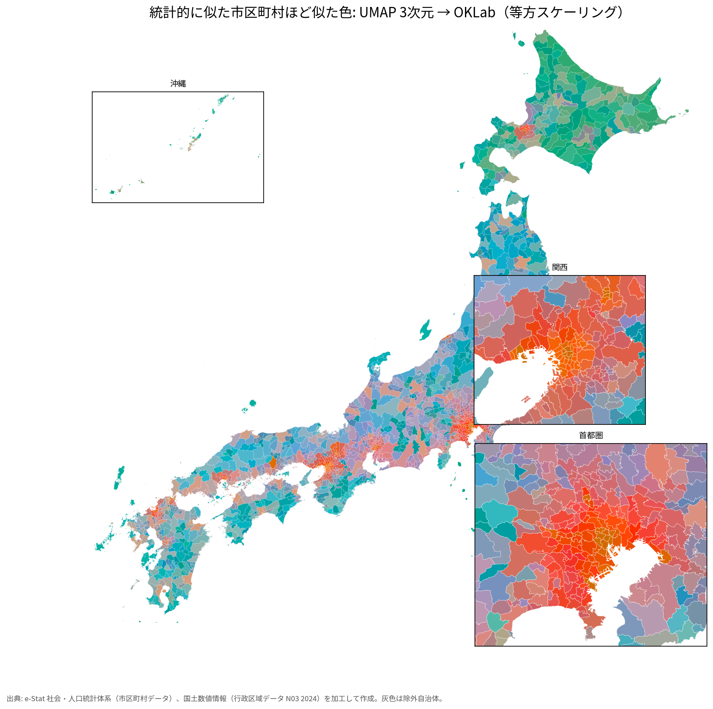
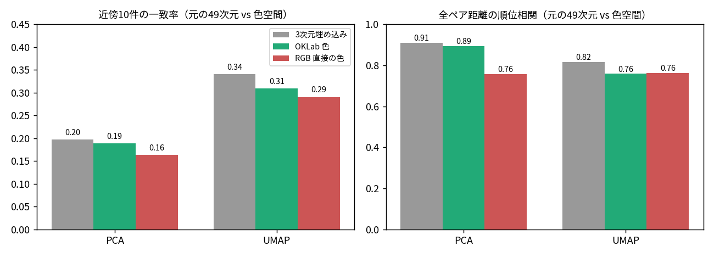
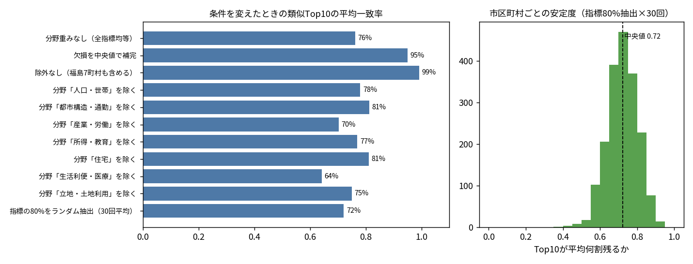
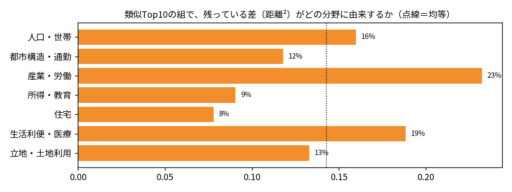
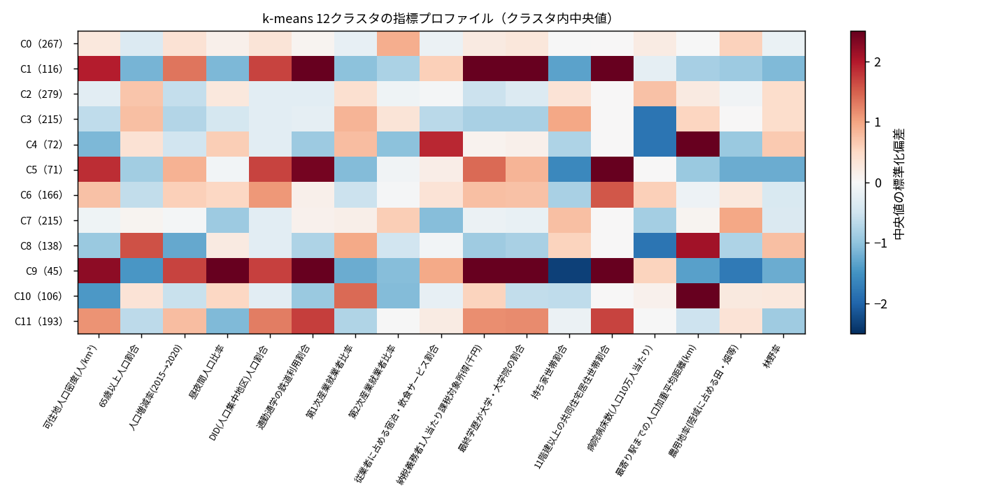
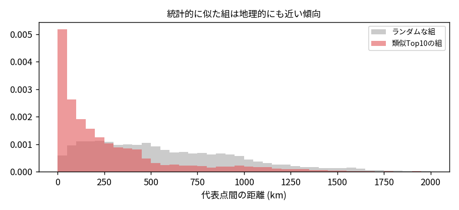
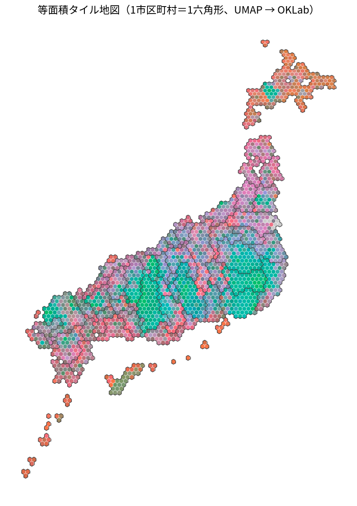

# 検証レポート: 市区町村の統計的類似度と色分けマップ

このレポートは、本リポジトリの手法が「統計上似た市区町村を似た色で表す」という目的に対してどの程度妥当かを、定量的な検証と具体例でまとめたものです。数値と図は `scripts/09_report_figures.py` で再生成できます（集計値は [`report_stats.json`](report_stats.json)）。

## 1. 要旨

- **対象と指標**: 全国 1,890 地域（政令市は区単位）、7 分野・49 指標。このうち福島県の 7 町村は類似度の計算から除外しています。
- **類似 Top10 は条件を変えてもおおむね保たれます**
  - 補完方法や除外ルールを変えても、Top10 の 95% 以上が残ります。
  - 指標の重み付けや分野の選び方を変えると、64〜81% が残ります。
  - 地域ごとに見ると、安定度の中央値は 0.72 です。安定度が 0.6 未満と不安定な地域は 6.5% です。
- **3 次元化と配色**
  - 3 次元に圧縮すると、細かな近傍関係は大部分が失われます。近傍 10 件の一致率は UMAP で 0.34、PCA で 0.20 です。
  - 一方、大まかな距離関係は保たれます。全ペア距離の順位相関は PCA で 0.91、UMAP で 0.82 です。
  - したがって、地図の色は「大まかな類型」を表すものとして読むのが適切です。個別の類似先は、元の 49 次元で計算した Top10 を参照してください。
- **OKLab と RGB 直接の比較**
  - OKLab は近傍の一致率でどちらの手法でも RGB 直接を上回り、PCA では距離の順位相関でも大きく上回ります（0.89 対 0.76）。
  - UMAP の距離の順位相関だけは、両者がほぼ同じでした（0.76 対 0.76）。
- **地理との関係**
  - 地理情報は指標に直接は入れていません。それでも類似 Top10 の 28% は同じ都道府県の地域です（ランダムなら 3%）。
  - 地域性が統計に表れている結果と考えられます。ただし、県単位でまとまって決まる要素（気候や医療圏など）が混ざっている可能性もあります。

## 2. データと手法（概要）

詳細は [README](../README.md) を参照してください。

1. **指標**: e-Stat「社会・人口統計体系」、2020 年国勢調査、国土数値情報（駅・医療機関・土地利用・行政区域）、250m メッシュ人口から作成しました。
2. **規模の影響を除く**: 総人口や施設数のような規模の指標は、比率・密度・人口当たりの値に直しました。
3. **標準化**: 偏った分布の指標は対数または平方根で変換し、中央値と IQR で標準化しました（±4 で打ち切り）。
4. **欠損値**: KNN 補完で埋めました。
5. **分野の重み**: 各指標に 1/√(その分野の指標数) の重みを掛け、7 分野の寄与を揃えました。そのうえでユークリッド距離を計算し、各地域の類似 Top10 を求めています。
6. **3 次元化と配色**: PCA と UMAP で 3 次元に落とし、3 つの軸を OKLab の明度・赤緑・青黄に割り当てました（スケールは 3 軸で共通）。

## 3. 3 次元化と色変換の検証

指標は 2 つ使いました。

- **近傍 10 件の一致率**: 元の 49 次元での近傍 10 件と、色空間での近傍 10 件がどれだけ重なるか
- **全ペア距離の順位相関**: すべての地域の組について、49 次元での距離と色空間での距離の順位がどれだけ一致するか

主な結果です。

- **手法による違い**
  - UMAP は近傍（似たもの同士）をよく保ちます。Trustworthiness は 0.947、近傍の一致率は 0.34 です。
  - PCA は全体の距離関係をよく保ちます。距離の順位相関は 0.91 です。
  - 49 次元を 3 次元に落とす以上、近傍が完全に保たれることはありません。
- **色に変換したときの劣化**
  - OKLab に変換したとき、埋め込みからの劣化は小さく抑えられています（PCA の距離相関は 0.91 → 0.89）。
  - RGB 直接では、PCA の距離相関が 0.76 まで下がります。
- **UMAP で差がつかない理由**: UMAP は大域的な距離をもともと保証しない手法なので、色空間の均等性の差が表れにくいと考えられます。

## 4. 感度分析

ベースラインの設定は、分野ごとに均等な重み、KNN 補完、福島 7 町村の除外、全 49 指標です。条件を変えたとき、各地域の類似 Top10 が平均何件一致するかを調べました。

- **ほとんど影響しない条件**: 欠損の補完方法を変えても 95%、除外ルールを外しても 99% 一致しました。
- **影響の大きい条件**: 分野の重みを外すと 76%、分野を 1 つ除くと 64〜81% でした。いちばん影響が大きいのは「生活利便・医療」を除いた場合です（64%）。
- **指標の選び方への依存（安定度）**
  - 指標の 80% をランダムに選んで 30 回計算し直すと、Top10 の平均一致率は 72% でした。
  - 地域ごとの安定度は、0.8 以上が 17%、0.6 未満が 6.5% です。
  - 不安定な例は、直島町（0.40）、日の出町、小坂町、芦屋町などです。似た地域が少なく、どの指標を使うかで Top10 が入れ替わりやすい地域と考えられます。
- **UMAP の設定**
  - n_neighbors（10/20/50）、min_dist（0.1/0.3/0.6）、乱数シードを変えました。
  - 色の大域的な配置はほぼ変わりませんでした（既定設定との距離相関 0.976 以上）。
  - 細かな近傍は入れ替わります（既定設定との近傍一致 0.58〜0.76）。

## 5. 類似の中身: Top10 の組に残る差

類似 Top10 の組について、残っている距離²がどの分野に由来するかを平均しました。分野の重みは揃えてあるので、偏りがなければ各分野 14% になります。

- **差が残りやすい分野**: 「産業・労働」（23%）と「生活利便・医療」（19%）
  - 指標単位で見ると、診療所数・医師数・飲食店数・病床数（いずれも人口当たり）が上位です。
  - これらは規模の小さい町村ほど値が大きく振れる指標です。似た地域同士でも差が残りやすく、類似先の選ばれ方にも強く効きます（感度分析で、この分野を除いた場合に一致率が最も下がったことと整合します）。
- **差が残りにくい分野**: 「住宅」（8%）と「所得・教育」（9%）
  - 似た地域同士ではほぼ揃っている分野です。

Web マップで Top10 の行をクリックすると、この内訳を組ごとに表示します。あわせて、「共通の特徴」（両方とも全国中央値から同じ向きに離れている指標）と「主な違い」（距離²への寄与が大きい指標）も表示します。

## 6. 典型例の確認

| 地域 | 類似 Top5 | 安定度 |
|---|---|---|
| 東京都 渋谷区 | 新宿区、大阪市北区、大阪市中央区、横浜市西区、港区 | 0.91 |
| 大阪市北区 | 大阪市中央区、神戸市中央区、渋谷区、名古屋市中区、福岡市中央区 | 0.88 |
| 千葉県 浦安市 | さいたま市中央区、大田区、府中市（東京）、吹田市、習志野市 | 0.68 |
| 愛知県 豊田市 | 岡崎市、四日市市、小牧市、安城市、半田市 | 0.80 |
| 長野県 軽井沢町 | 山中湖村、富士河口湖町、白馬村、久山町、北杜市 | 0.73 |
| 北海道 夕張市 | 上川町、福島町（北海道）、白糠町、岩泉町、室戸市 | 0.62 |
| 東京都 新島村 | 神津島村、三宅村、大島町、海士町、屋久島町 | 0.74 |
| 沖縄県 与那国町 | 北大東村、南大東村、竹富町、渡嘉敷村、神津島村 | 0.79 |
| 香川県 直島町 | 高浜町、女川町、寿都町、土庄町、中札内村 | 0.40 |

- 大都市の都心区、製造業の都市、リゾート、旧産炭地・過疎地、離島は、どれも直感に合う類似先が並びました。
- 直島町だけは類似先にまとまりがなく、安定度も低い結果です。島で、観光業があり、病院がないという組み合わせを持つ地域が全国にほとんどないためと考えられます。

## 7. 類型（k-means 12 クラスタ）

類型の名前は、クラスタ内の中央値と代表的な地域を見て付けた解釈です。

| クラスタ | 地域数 | 特徴（中央値の偏差が大きい指標） | 代表例 | 解釈 |
|---|---|---|---|---|
| C9 | 45 | 昼夜間人口比率↑、高層住宅↑、自家用車通勤↓、所得↑ | 名古屋市中村区、横浜市中区、京都市中京区 | 大都市の都心 |
| C1 | 116 | 鉄道通勤↑、自家用車通勤↓、高層住宅↑、大卒↑ | 習志野市、さいたま市北区、船橋市 | 大都市圏の鉄道沿線の郊外 |
| C5 | 71 | 高層住宅↑、自転車通勤↑、鉄道通勤↑ | 尼崎市、京都市伏見区、名古屋市北区、東大阪市 | 大都市の周辺区・工業都市 |
| C11 | 193 | 鉄道通勤↑、高層住宅↑、DID↑ | 久喜市、牛久市、一宮市、桶川市 | 大都市圏の外側の郊外 |
| C6 | 166 | 高層住宅↑、医師数↑、民営借家↑、DID↑ | 倉敷市、郡山市、高崎市 | 地方の中核都市 |
| C0 | 267 | 第 2 次産業↑、製造業↑、農用地↑ | 千曲市、栃木市、富士宮市 | 製造業のある地方都市 |
| C7 | 215 | 世帯人員↑、農用地↑、単独世帯↓ | 桜川市、浅口市、益子町 | 平地の農村・兼業地域 |
| C2 | 279 | 高齢単身↑、病床↑、自然減↑ | 臼杵市、長門市、大田市 | 高齢化の進む地方の小都市 |
| C3 | 215 | 病床↓、人口移動↓、持ち家↑ | 遠野市、那珂川町、大江町 | 病院の少ない農山村 |
| C8 | 138 | 駅まで遠い、高齢単身↑、低学歴↑、病床↓ | 西和賀町、那賀町、神山町 | 過疎化の進む山間の町村 |
| C10 | 106 | 駅まで遠い、人口密度↓、第 1 次産業↑ | 本別町、足寄町、平取町 | 北海道などの広域の農業町村 |
| C4 | 72 | 駅・病院まで遠い、診療所↑、失業率↓ | 利尻富士町、神津島村、屋久島町 | 離島 |

## 8. 地理的な近さ

- **数値**
  - 類似 Top10 の組の距離の中央値は 160km で、ランダムな組（505km）よりずっと近い結果でした。
  - 100km 以内にある組は 39% です（ランダムなら 8%）。
  - 同じ都道府県の組は 28% です（ランダムなら 3%）。
- **解釈**
  - 気候・産業構造・通勤圏など、地域性が統計に表れていると考えられます。
  - 一方で、都道府県ごとにまとまって決まりやすい要素（医療計画による病床の配置、県ごとの統計の取り方の差など）が混ざっている可能性もあります。この 2 つは、このデータだけでは切り分けられません。
- **地図への影響**: 地図上で色が地域ごとにまとまって見えるのは、この性質によるものです。似た色が隣り合うのは自然なことで、手法の誤りではありません。

## 9. 等面積タイル地図

- **目的**: 通常の地図では、北海道や山間部の面積が大きい町村が見た目を支配し、地域数で全体の約 3 分の 1 を占める大都市圏の区や市はほとんど見えません。そこで、1 地域を 1 つの六角形で表すタイル地図を用意しました（Web マップの「表示: タイル（等面積）」）。
- **作り方**（`scripts/08_tile_layout.py`）
  1. 隣接する地域同士をばねでつないだ力学的な配置で、密集地を押し広げ、まばらな地域を縮めます。
  2. 六角形のセルへ、移動距離の総和が最小になるように割り当てます。
  3. 都道府県の境界が分断されにくいように、隣接セルとの入れ替えで局所的に改善します。
- **制約**
  - 元の位置からの移動は中央値で約 60km、最大で約 250km あります。
  - 島嶼部以外にも、いくつかの県（三重県、石川県など）でタイルが 2 つに分かれる箇所が残っています。
  - 沖縄県と小笠原村は本土寄りに移動して表示しています。
  - タイル地図は「どの類型がどれだけの地域数を占めるか」を見るためのものです。正確な位置関係は通常の地図で確認してください。

## 10. 前提と限界

- **色そのものに意味はありません**
  - 色が近ければ統計的傾向が近い、ということだけを表します。
  - 軸の向きや回転には任意性があり、設定を変えると色の割り当ては変わります。
  - 政策上の良し悪しや順位を表すものではありません。
- **何をもって「似ている」とするかは指標の選び方次第です**
  - 結果は指標の選び方と重み付けに依存します（4 章）。特に「生活利便・医療」の扱いが Top10 に強く効きます。
  - 人口規模は意図的に指標から外しています。そのため、人口 300 万人の区と 3 万人の市が「似ている」と判定されることがあります。
- **データの年次がそろっていません**
  - 経済センサスは 2014 年、土地利用は 2021 年、国勢調査は 2020 年、人口動態は 2023〜2024 年です。
  - 統計は浜松市の 2024 年の区再編に対応していないため、浜松市は市単位で扱っています。
- **小さな町村では値が不安定です**: 人口当たりの施設数・医師数は、人口が小さいと値が大きく振れます。
- **指標の定義上の注意**
  - 「病院」は医療法上の病院（20 床以上）だけで、診療所は含みません。
  - 駅のない離島では、駅までの距離が本土の駅までの距離になります。
- **除外した地域**: 福島県の 7 町村は、震災・原発事故の影響で 2020 年の人口が 2010 年の半分未満になっているため、類似度の計算から除外しています。
- **3 次元化による情報の損失**: 3 次元の色では近傍の約 3 分の 2 が失われます（UMAP の近傍一致率は 0.31）。個別の比較には Top10 と「似ている点・違う点」の表示を使ってください。
